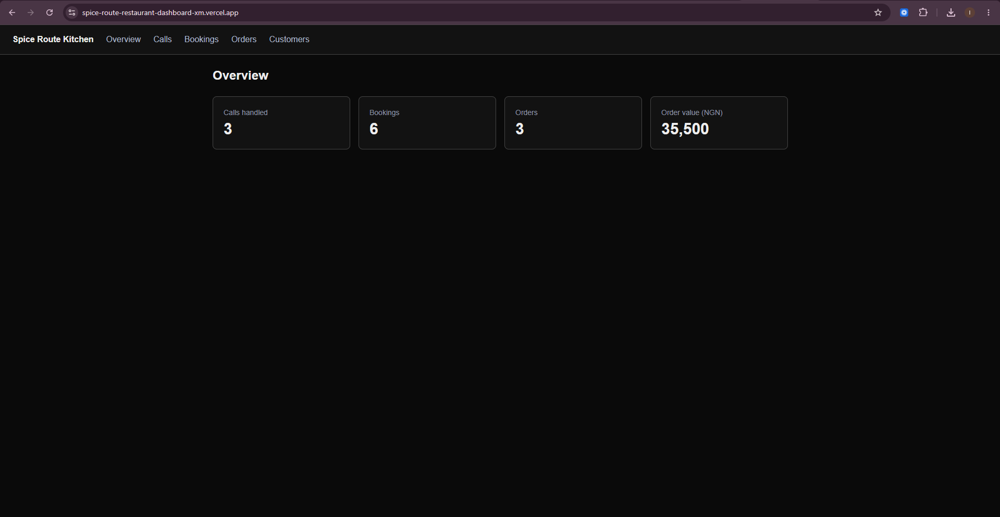
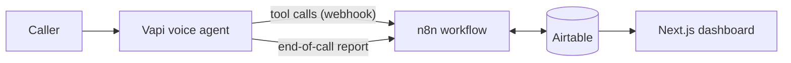

# 📞 AI Restaurant Receptionist

**A voice AI agent that answers every call, books tables, takes food orders, and shows it all on one dashboard.**


[▶ Watch the 3-minute demo](YOUR_VIDEO_LINK) · [Open the live dashboard](https://spice-route-restaurant-dashboard-xm.vercel.app/)



> **Note:** The demo uses a fictional restaurant, *Spice Route Kitchen*, and made-up customer data. No real personal information is stored in this repository.

---

## The problem

Restaurants are busiest exactly when nobody has time to answer the phone. Every missed call is a booking or an order that goes to a competitor, and staff who do answer are pulled away from guests in the room.

## The solution

An AI receptionist named **Alex** picks up every call, 24/7. She answers questions, checks real table availability, takes reservations and orders, and logs everything. The owner sees the whole day on a simple dashboard.

## What the restaurant gets

| Benefit | How |
|---|---|
| **No missed calls** | The agent answers every call, even at peak hours |
| **No double-bookings** | Availability is checked against saved bookings before confirming |
| **Correct bills** | Prices come from the menu in the workflow, not from the AI's memory |
| **Less staff interruption** | FAQs, bookings and orders are handled automatically |
| **Full visibility** | Every call has a summary and transcript on the dashboard |

## Features

- 🗣️ Natural voice conversation (hours, menu, parking, allergies, policies)
- 📅 Table reservations with live availability check and confirmation code
- 🍽️ Pickup and delivery orders with automatic total calculation
- 🚫 Safe handling of unknowns: no invented dishes, no allergen promises, manager callback instead
- 📝 Call log with AI summary, transcript, duration and cost
- 📊 Dashboard: Overview, Calls, Bookings, Orders, Customers

## How it works



1. A customer calls. **Vapi** listens, thinks and speaks.
2. When the agent needs to check or save something, it calls a **tool**. Vapi sends that request to an **n8n** webhook.
3. n8n checks availability, saves bookings and orders in **Airtable**, and replies with a result the agent reads out.
4. When the call ends, Vapi sends a report (summary, transcript, cost) and n8n saves it.
5. The **Next.js dashboard** reads Airtable and displays everything.

## Tech stack

| Layer | Tool |
|---|---|
| Voice agent | Vapi (speech-to-text, LLM, text-to-speech) |
| Automation / backend logic | n8n |
| Database | Airtable |
| Dashboard | Next.js (React, TypeScript, Tailwind CSS) |
| Hosting | Vercel (dashboard), n8n Cloud or self-hosted n8n |

## Project structure

```
.
├── app/                    # Dashboard pages (Overview + list pages)
├── components/             # Reusable table component
├── lib/airtable.ts         # Reads records from Airtable
├── n8n/
│   └── restaurant-brain.json   # Exported n8n workflow (import this)
├── vapi/
│   ├── system-prompt.md        # The agent's rulebook
│   └── tools/                  # check_availability, create_reservation, create_order
├── docs/
│   ├── airtable-schema.md      # Tables and field names
│   └── images/                 # Screenshots
├── .env.example
└── README.md
```

## Quick start

**Time needed:** about 45 minutes. **Accounts needed:** Airtable, n8n, Vapi, Vercel (all have free tiers or trials).

### 1. Clone the repo

```bash
git clone https://github.com/ifedayofakayode/spice-route-restaurant-dashboard.git
cd YOUR-REPO
npm install
```

### 2. Set up Airtable

1. Create a base called `restaurant-agent`.
2. Create the tables `reservations`, `orders` and `calls` with the exact field names in [`docs/airtable-schema.md`](docs/airtable-schema.md).
3. Create a Personal Access Token with scopes `data.records:read`, `data.records:write`, `schema.bases:read`, with access to your base.

### 3. Import the n8n workflow

1. In n8n choose **Workflows, Import from File** and select `n8n/restaurant-brain.json`.
2. Open each Airtable node, select your Airtable credential and your base.
3. Switch the workflow to **Active** and copy the **Production URL** of the Webhook node.

### 4. Create the Vapi assistant

1. Create an assistant and paste the contents of [`vapi/system-prompt.md`](vapi/system-prompt.md) as the system prompt.
2. Create the three tools from `vapi/tools/`, setting each **Server URL** to your n8n Production URL.
3. In the assistant's server settings use the same URL and enable the `tool-calls` and `end-of-call-report` messages.

### 5. Run the dashboard

Copy `.env.example` to `.env.local` and fill it in:

| Variable | What it is |
|---|---|
| `AIRTABLE_TOKEN` | Your Airtable Personal Access Token |
| `AIRTABLE_BASE_ID` | The base ID (starts with `app`) |

```bash
npm run dev
```

Open <http://localhost:3000>.

## Example call

> **Alex:** Thank you for calling Spice Route Kitchen, this is Tola. How can I help you today?

> **Caller:** I'd like a table for four on Saturday at eight.

> **Alex:** Lovely. Can I take your name?

> **Caller:** Chidi Okeke.

> **Alex:** Thanks Chidi. And a phone number?

> *(Alex checks availability, repeats the details, and after a yes, saves the booking.)*

> **Alex:** You're all set. Your confirmation code is S R K, four eight two one.


## Test scenarios

| # | Scenario | Expected result |
|---|---|---|
| 1 | Ask about opening hours and parking | Correct answer, no tool used |
| 2 | Book a table for 4 | Row in `reservations` with a confirmation code |
| 3 | Book a fully booked slot | Agent says it is full and offers another time, no new row |
| 4 | Pickup order: 1 Jollof Rice with Grilled Chicken, 2 Chapman | Total 11,500 naira saved in `orders` |
| 5 | Order a dish that is not on the menu | Agent declines politely, no new row |
| 6 | Ask if a dish is allergen-free | Agent will not promise, offers manager callback |
| 7 | Hang up | A row appears in `calls` with summary and transcript |

## Security and privacy

- Secrets live in environment variables and are never committed.
- The Airtable token is used only on the server, never in the browser.
- Before using real customer data: protect the n8n webhook with a secret header, add a login to the dashboard, tell callers they are speaking to an AI and that calls may be recorded, and follow local data protection rules.

## Roadmap for Improvement

- [ ] Cancel and change reservations by phone
- [ ] WhatsApp / SMS confirmations
- [ ] Google Calendar sync
- [ ] Order status buttons on the dashboard
- [ ] Hand the call to a human on request
- [ ] Dashboard login

## Author

Built by **Ifedayo Steven Fakayode** · [LinkedIn](https://www.linkedin.com/in/ifedayofakayode/) · [Email](mailto:steven.fakayode@gmail.com)

Want a version like this for your restaurant? Get in touch.

## License

MIT. See [LICENSE](LICENSE).
